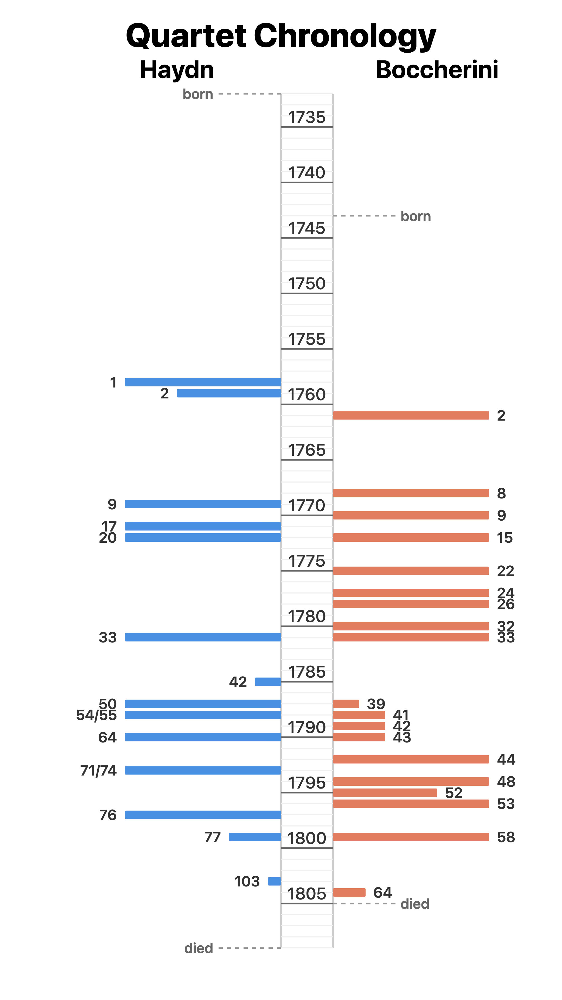

# Two Lives in Quartets

Haydn and Boccherini were near-contemporaries, and both wrote string
quartets for most of their lives. This chart sets their quartets side by
side on a shared timeline: one bar per opus, one segment per quartet,
with lifetime totals of quartets and movements at the bottom.

<p align="center">
  
</p>

Print-ready versions: [US Letter PDF](output/timeline-letter.pdf),
[A4 PDF](output/timeline-a4.pdf), [SVG](output/timeline.svg).

## How it has changed

It started as a Claude artifact
([original](https://claude.ai/public/artifacts/0588cef3-6f5f-4f62-aba6-17b316a9cf2e)).
The first version committed here spanned both lifetimes and had no
totals:

<table>
  <tr>
    <th>First version</th>
    <th>Now</th>
  </tr>
  <tr>
    <td><a href="https://github.com/jsundram/boccherini-haydn-timeline/blob/b3fcd366ec949860635c43180abc780ce05a94ec/output/timeline.png"></a></td>
    <td></td>
  </tr>
</table>

Every iteration in between is saved in [`explorations/`](explorations/).
The reference mockup for the editorial redesign is in [`docs/`](docs/).

## Files

- `index.html` — the chart source, self-contained
- `capture.mjs` — Playwright script that renders `index.html` and writes captures
- `output/` — generated captures (committed, so the latest renders travel with the repo)
- `explorations/` — a PNG of each design iteration
- `docs/` — reference material

## Setup (once)

```sh
npm install
npx playwright install chromium
```

## Capture

```sh
npm run capture
```

The page lays itself out for a page format chosen with `?format=`:
`story` (1080x1920, the default), `letter` (US Letter) or `a4`. The script
captures each format in turn. It finds the chart element itself (largest
inline `<svg>`, or `--selector`), sizes the viewport to exactly its natural
dimensions, and writes to `output/`:

- `timeline.{png,svg,pdf}` — story format; PNG at 2x (2160x3840)
- `timeline-letter.{png,svg,pdf}` — US Letter; PNG at 300 dpi (2550x3300)
- `timeline-a4.{png,svg,pdf}` — A4; PNG at 300 dpi (2481x3509)

The SVGs have page styles inlined and import the web font, and each PDF
is a single page sized exactly to its format.

Options:

```sh
node capture.mjs --format letter       # just one format
node capture.mjs --selector "#chart"   # explicit capture target
node capture.mjs --scale 3             # override the PNG scale
node capture.mjs --file other.html
```

The title, composer names and summary use Source Serif 4 from Google
Fonts; offline, they fall back to Georgia. Design constants (type sizes,
spacing, colors, summary rows) live in the `design` object at the top of
the script in `index.html`.

## View locally

Just open `index.html` in a browser, or `npm run serve`.
